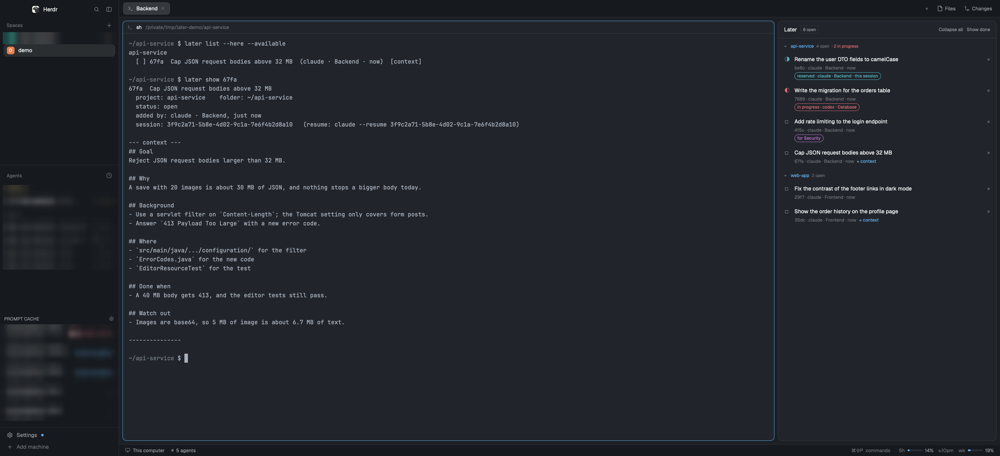
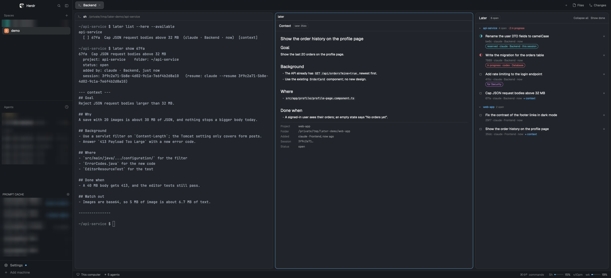

# herdr-mmc-mods

My mods for [herdr](https://github.com/herdrdev/herdr), the app where you run many coding agents side by side. There is one mod for now: **Later**.

It works in the Herdr desktop app (Herdr.app) and in the herdr terminal app, on macOS, Linux and Windows.

---

## Later

**One shared to-do list for you and all your agents.**

When you work with an agent, you often say *"let's do that later"*. Normally, that idea is lost in the chat. With Later, the agent writes it down in a list that you always see, next to your agents. Later, you or any agent can pick it up.



### What you can do

- **Save work for later.** Tell your agent "let's do that later". It adds the to-do to the list for you.
- **See everything in one place.** The Later panel shows the to-dos of every agent, grouped by project.
- **Give a to-do to an agent.** Tell an agent "pick a to-do", or click **Start agent** on an item.
- **Never do the same work twice.** When one agent takes a to-do, the others skip it.
- **Start with all the facts.** A to-do for a new agent comes with a short note that explains what to do, why, where and when it is done.

### How it works, in four steps

1. **You defer something.** You say to an agent: *"The size limit can wait, let's do it later."*
2. **The agent saves it.** It decides who will do it:
   - **you two, later in this chat**: the item is *reserved* for this agent;
   - **someone new**: the agent writes a short context for the next agent.

   The agent asks you only when it cannot tell.
3. **You see it in the panel.** The item appears at once, under its project.
4. **An agent does it.** You say *"pick a to-do"*, or you click **Start agent**. The agent marks the item *in progress*, does the work, and marks it *done*.

### What the items look like

| Mark | Meaning |
|---|---|
| ☐ | **Open.** Nobody is working on it. Any agent can take it. |
| ◑ *reserved · this session* | The agent that added it will do it in the same chat. Other agents skip it. |
| ◐ *in progress · codex · Database* | This agent is working on it now. |
| *for Security* | Only the agent in the tab called "Security" should do it. |
| *taken 5h ago* (red) | Taken long ago. Maybe the agent stopped. Click **Unassign** to free it. |
| ≡ context | It has a context note for a new agent. |
| ☑ | **Done.** Click **Show done** to see these items. |

### Talk to your agents

You do not need to learn commands. Just say it:

| You say | The agent… |
|---|---|
| "Let's do that later." / "Add that to later." | adds a to-do, and a context if a new agent will do it |
| "Pick a to-do." | lists the to-dos of its project, proposes one and says why, and waits for your yes |
| "Do later item 8a70." | takes that to-do and starts |
| "What is on the later list?" | shows the list |

When an agent finishes, it marks the item done. When it stops before the end, it frees the item for another agent.

### The panel

**Click an item** to open it. You see its context, its details (project, folder, who added it, status) and these buttons:

| Button | What it does |
|---|---|
| **Start agent** | Opens a new tab with Claude Code (or another agent you have) in the right folder. The to-do is its first message. |
| **Send to…** | Gives the to-do to an agent that is already open, but only when that agent is not busy. |
| **Resume session** | Opens the original Claude Code chat where the to-do came from, with everything you said there. |
| **Unassign** | Frees an item that an agent has, so anyone can take it again. It does not change any code. |
| **Copy id** | Copies the item's id, for example `8a70`, so you can say "do later item 8a70". |
| **Open in a pane ↗** | Shows the context larger, next to your terminal. |

Also in the panel:

- Click a project name to fold or unfold its group. **Collapse all** folds every group.
- Click ☐ to mark an item done.
- Click **×**, then **Remove**, to delete an item.
- Press **⌘⇧T** (Command + Shift + T) to hide or show the panel.



### Install

**Herdr desktop app** (Herdr.app):

```sh
git clone https://github.com/mmcorrelo/herdr-mmc-mods.git
cd herdr-mmc-mods
node install-desktop.mjs
```

Keep the Herdr app open while you run it. The Later panel appears on the right of the window. That is all.

The installer:

- copies the mod into the app's mods folder
- adds **⌘⇧T** to the app's keys (only if that key is free; it backs up your keys first)
- checks that the mod loads

To update, run `git pull` and then `node install-desktop.mjs` again.

**herdr terminal app** (`herdr` in a terminal):

```sh
herdr plugin install mmcorrelo/herdr-mmc-mods/later
```

Then restart herdr. Press `prefix+t` (Control+B, then T) to open the list. `herdr plugin update` updates it.

**Your agents** learn how to use the list by themselves: when the mod starts, it installs a small skill for Claude Code and Codex. Other agents can use the `later` command too, if you tell them about it in their instructions.

### Requirements

- The Herdr desktop app, or herdr 0.9 or later
- [Node.js](https://nodejs.org) 18 or later. Nothing else to install. Node from nvm, Volta or Homebrew is found too.

### Questions

**Where is my list saved?**
On your computer, one small file per item, in `~/.config/herdr/plugins/config/mmc.later/items/`. Nothing goes to the internet.

**Do my other computers see the list?**
No. The list is on this computer only.

**What if two agents take the same to-do at the same time?**
Only one of them gets it. The other one is told who has it, and it can pick another to-do.

**Which agents can use it?**
Every agent on this computer. Claude Code and Codex know how by themselves. Other agents can use the `later` command when you tell them about it.

**How do I remove it?**
In the terminal app, run the action "Later: undo the setup". In the desktop app, delete `~/.config/herdr-app/mods/later`. Your items stay in their folder until you delete them.

### Commands, for the curious

Agents use these commands. You can use them too, in any terminal:

```
later add "text" [--brief "…"] [--context-file file] [--session] [--for tab] [--project name]
later list [--here] [--available] [--all]
later show <id>        later take <id>        later unassign <id>
later done <id>        later reopen <id>      later rm <id>
later copy <id>
```

---

## Working on this repository

- Make changes on the `dev` branch.
- The `later` command and its agent skill live in `later/`.
- The desktop mod in `mods/later/` needs its own copy of them, because each mod folder must work alone. After you change `later/bin/later.mjs` or `later/skill/SKILL.md`, run `node tools/sync.mjs`. `node tools/sync.mjs --check` fails when the copies differ.
- Check the desktop mod with `herdr-app check mods/later`.

## License

MIT
