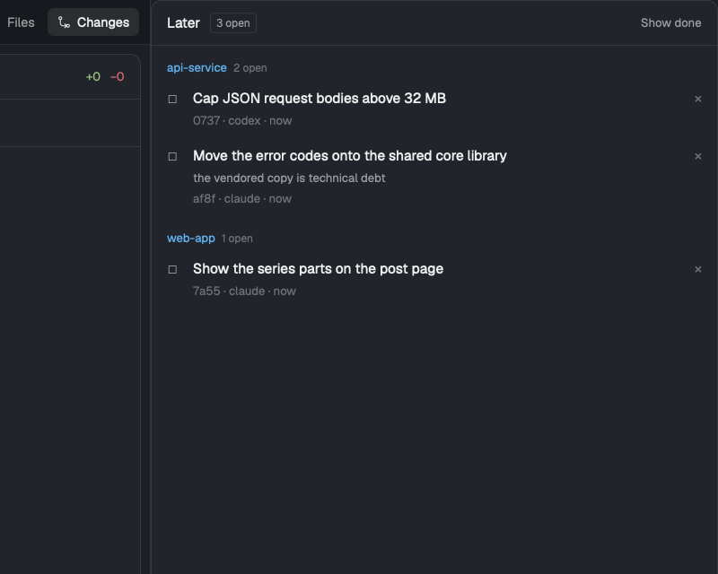

# Later

A panel on the right of the window with one shared list of the work you and your agents agreed to do later. Any agent in any space adds an item with the `later` command; the panel shows it at once, grouped by project, and posts a notification.

## What you see

- **Header**, 42px: "Later", a small bordered badge "N open", and "Show done" / "Hide done" on the right in the muted color.
- **List**, scrolling: one group per project (the git repository the agent worked in): a ▾ / ▸ header with its name in the accent color, "N open" in the dim color and "· N in progress" in the blocked color. Items in progress come first. Each item is a row: a ☐ box (☑ in ansi2 green when done), the text (dim and struck through when done), the note in 11px muted text when there is one, and "id · agent · space · age" in 11px dim text. Under it, pill chips: "in progress · claude · Frontend" (blocked color), "taken 5h ago" (ansi1) when taken more than 4 hours ago, "for Frontend" (ansi5) when assigned. Then small buttons: **Start agent**, **Send to…** and **Copy id** on an open item; **Unassign** and **Copy id** on one in progress. The brief (the note) shows under the text with a left border. A × on the right removes the item after "Remove / Keep".
- **Empty**: "Nothing for later. When you and an agent agree to do something later, it appears here."
- The panel is 320px wide, docked on the right, with the theme's background, border and 10px corners like the Changes panel.

## How it behaves

- An item is compact until clicked: its text, "id · agent · tab · age", "≡ context" in the accent color when it has one, and its chips. Clicking it opens it in place (one at a time, on the raised color with a border): the context rendered as markdown (TextView.markdown), the brief when there is no context, the details (Project, Folder, Added, Session, Status, For), then the buttons and, with a context, "Open in a pane ↗" (`pane.split` right with this mod and props `{ view: "context", id }`, which renders only that item's context and details).
- **Resume session** (items from Claude Code with a session id) runs `tab.new` with `argv: ["claude", "--resume", <session>]` in the item's folder and the item as the task.
- A reserved item ("reserved · agent · this session", ansi6) belongs to the agent that added it for its own session; Unassign makes it open.
- Clicking the box marks the item done or open again. "Show done" shows done items too. Clicking a group header closes or opens it; "Collapse all" / "Expand all" does every group. Closed groups are kept in localStorage, and a group opens by itself when one of its items is taken.
- **Start agent** shows the installed agent programs (`knownAgents()`); picking one runs `tab.new` with the item's folder, the program's `run` argv, the tab name "Later <id>" and the task "Do later item <id>: … take it first, do the work, then mark it done".
- **Send to…** shows the open agents (`agents()`, by tab name, busy ones marked); picking one runs `hc send --if idle <address> <task>`, so a working agent is never interrupted.
- **Unassign** runs `later unassign <id>`; **Copy id** runs `later copy <id>`.
- A notification posts when an item is added and when one is taken.
- A new item from any agent appears within a moment and posts a notification "Later · <project>".
- Ages ("now", "5m", "2h", "3d") refresh every minute.
- `cmd-shift-t` shows or hides the panel (`layout.toggle:later`).

## Built from

- `main.js`: one View. Every read and write runs `node bin/later.mjs <command>` with `exec`: `ensure` once at start (it installs the agent skill for Claude Code and Codex), `where` for the item folder, `list --all --json` to load, `done`, `reopen`, `unassign`, `copy`, `rm`. It reloads after `watchFolder(<item folder>)` resolves.
- `bin/later.mjs`: the command itself, Node built-ins only. Items are one JSON file each in herdr's plugin config folder for `mmc.later` (`~/.config/herdr/plugins/config/mmc.later/items/`), shared with the terminal plugin of the same name.
- `skill/SKILL.md`: the agent skill template; `ensure` fills in the command's path.
- `mod.json`: `{ "place": "right", "size": 320, "title": "Later" }`. `keys.json`: `cmd-shift-t` → `layout.toggle:later`.

## Watch out

- The app may run programs without an interactive shell's PATH, where nvm puts node. `findNode` tries `node`, then `zsh` / `bash` / `fish -ilc "command -v node"`, then Homebrew, `/usr/local`, Volta and the newest nvm version, and keeps the one that answers in localStorage.
- The app docks a new mod under a random node id. The shortcut needs the id `later`, so after the dock, rename that node's id to `later` in the layout file (the repository's `install-desktop.mjs` does this).
- The mod runs programs (`node`, the login shells) and reads a folder outside its own (the item folder in `~/.config/herdr/plugins/config/mmc.later/`). It does not reach the network.

## Done when

- `herdr-app check mods/later` passes.
- `later add "test"` in any terminal shows the item in the panel within a second, with a notification.
- Clicking the box marks it done; "Show done" shows it struck through; × then "Remove" deletes its file.
- `cmd-shift-t` hides and shows the panel.
- With no Node installed, the panel says "Later needs Node.js 18 or later…".
